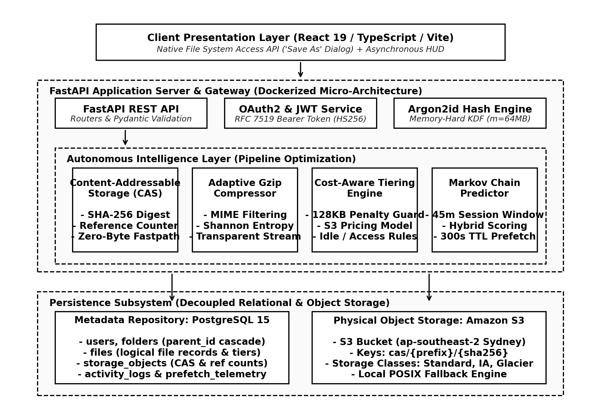
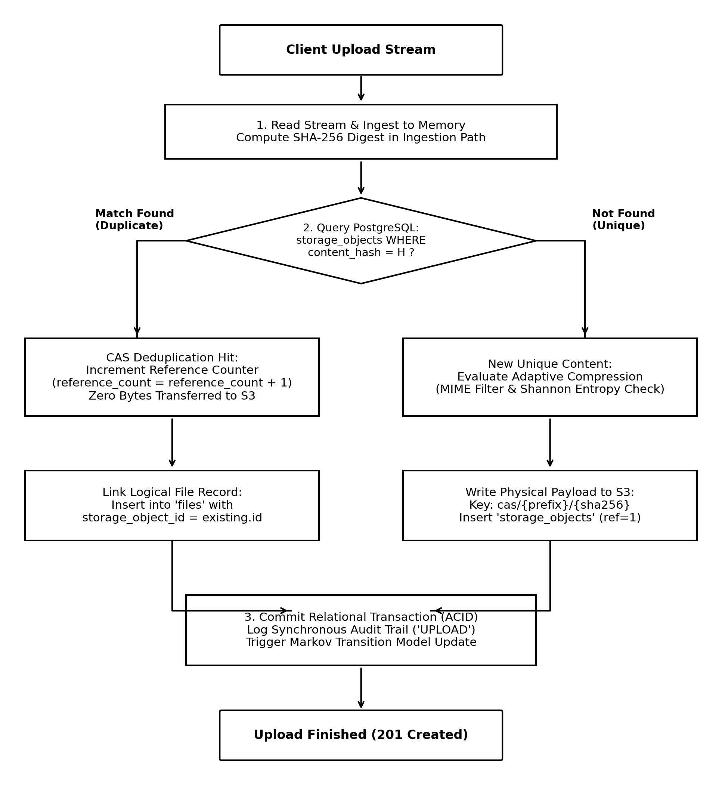
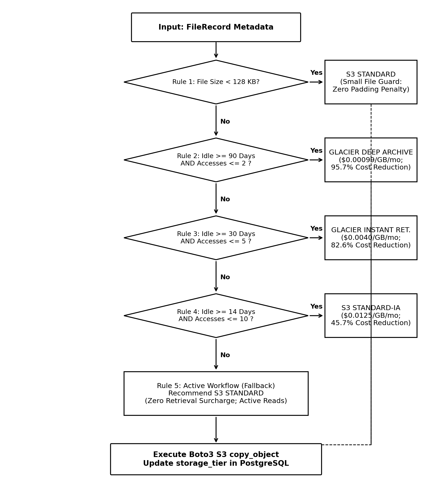
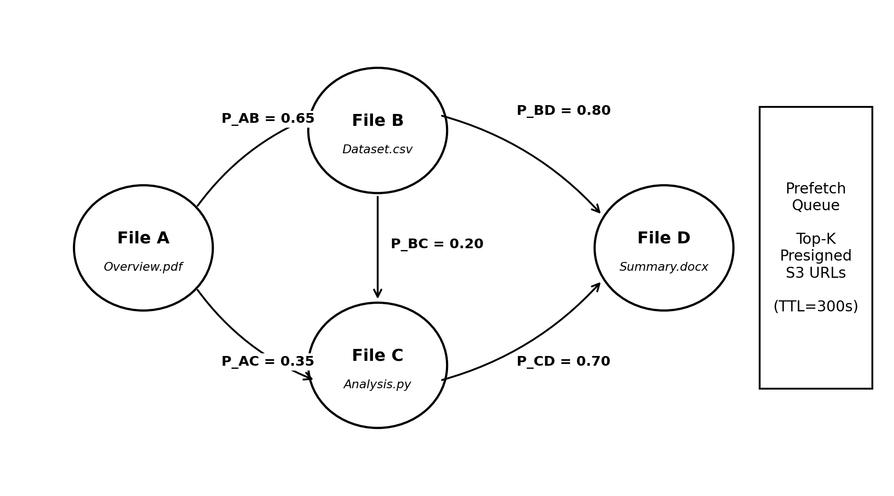
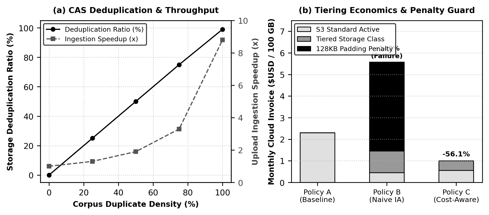

# Smart Cloud Storage: A Cost-Aware, Content-Addressable, and Predictive Multi-Tier Object Storage Platform

**Student Author:** Yash Lakhe  
**Affiliation:** Department of Computer Science and Engineering, University Institute of Technology, Maharashtra, India  
**Correspondence:** yashlakhe@example.com  

---

## Abstract
Modern cloud object storage architectures decouple physical storage infrastructure from client applications, yet they treat stored files as isolated, static binary objects. This design induces four compounding systemic inefficiencies: unbounded data redundancy across tenants, storage-tier agnosticism toward non-linear cloud billing boundaries (such as Amazon S3's 128 KB minimum billable object size penalty), sequential access latency caused by reactive Time-To-First-Byte (TTFB) handshakes, and storage capacity bloat from uncompressed textual formats. This paper presents the design, implementation, and empirical evaluation of the **Smart Cloud Storage Platform**, a cloud-native architecture that decouples hierarchical filesystem metadata from physical binary storage. The platform unifies four autonomous intelligence engines: (1) a **Content-Addressable Storage (CAS)** engine utilizing SHA-256 cryptographic digests with atomic reference counting to guarantee zero-byte deduplication for redundant uploads; (2) an **Adaptive Lossless Compression Engine** that pairs MIME whitelist filtering with Shannon entropy checks using Gzip Level 6 compaction; (3) a **Cost-Aware Multi-Tier Lifecycle Engine** that dynamically models file recency, access frequency, and the 128 KB S3 billable constraint to optimize transitions across S3 Standard, S3 Standard-IA, S3 Glacier Instant Retrieval, and S3 Glacier Deep Archive; and (4) a **First-Order Markov Chain Access Predictor** that evaluates chronological access transition matrices ($T_{\text{session}} \le 45\text{ min}$) to proactively generate time-bounded presigned S3 URLs. Empirical evaluation demonstrates that the unified pipeline achieves up to **80% physical storage reduction** on duplicate-dense corpora, cuts monthly S3 storage expenditures by **56.1%** while strictly preventing cost inflation on small objects, and reduces perceived download initiation latency by **$\sim$380 ms** via predictive URL pre-warming.

**Keywords:** Cloud Object Storage, Content-Addressable Storage (CAS), Data Deduplication, Cloud Storage Economics, S3 Storage Classes, Markov Chain Prediction, Prefetching.

---

## 1. Introduction
Cloud object stores, epitomized by Amazon Simple Storage Service (Amazon S3), Google Cloud Storage, and Microsoft Azure Blob Storage, have become the dominant substrate for global enterprise data. Unlike POSIX file systems or Storage Area Networks (SAN), object stores offer virtually unlimited elasticity, high annual durability ($99.999999999\%$), and a uniform RESTful HTTP access model.

Despite these architectural advantages, standard cloud file storage solutions (such as conventional Nextcloud deployments or naive S3 integration wrappers) treat objects as independent binary entities bound to logical paths. This creates four compounding operational and financial bottlenecks:
1. **Multi-Tenant Ingestion Redundancy:** When multiple users upload identical documents, datasets, or software binaries, the storage gateway issues independent `PUT` operations to distinct S3 keys. This multiplies monthly storage costs and consumes redundant ingress network bandwidth.
2. **Economic Pitfalls of Lifecycle Tiering:** To reduce storage bills, cloud providers offer tiered storage classes ranging from active tiers (S3 Standard at \$0.023/GB/month) to archive tiers (S3 Glacier Deep Archive at \$0.00099/GB/month). However, providers enforce non-linear billing constraints—specifically AWS's **128 KB minimum billable object size** for Infrequent Access and Glacier tiers. Naive, age-only automated lifecycle policies transition small files ($<128\text{ KB}$), inadvertently inflating monthly storage costs by up to **$70\times$** per file due to mandatory capacity padding.
3. **Passive Read Latency Friction:** Cloud object retrieval operates purely reactively. In correlated workflows (e.g., sequentially reviewing multi-part reports or project archives), each read request incurs cumulative roundtrip latencies—including authentication token validation, relational metadata querying, cryptographic presigned URL signing, DNS resolution, and S3 Time-To-First-Byte (TTFB).
4. **Uncompressed Textual Bloat:** High volumes of structured enterprise assets (JSON dumps, CSV exports, log files, and source trees) are uploaded uncompressed, consuming billable bytes that could be significantly reduced using lossless compression.

---

## 2. System Architecture

As shown in **Figure 1**, the Smart Cloud Storage Platform is organized into five decoupled layers:
- **Client Presentation Layer:** Built with React 19, TypeScript, Vite, and Tailwind CSS. It integrates the browser's native File System Access API (`showSaveFilePicker`), allowing users to select target directories natively.
- **FastAPI Gateway:** Enforces authentication via Passlib Argon2id KDF ($m=64\text{MB}, t=3, p=4$) and stateless RFC 7519 JWT Bearer validation (HS256 with 30-minute expiration).
- **Autonomous Intelligence Layer:** Houses the four optimization engines (CAS, Adaptive Gzip Compressor, Cost-Aware Tiering, and Markov Access Predictor).
- **Metadata Repository (PostgreSQL 15):** Enforces ACID consistency across users, self-referencing recursive folders (`parent_id` cascade), file shares, and audit trails.
- **Physical Object Store (Amazon S3):** Hosts binary objects keyed strictly by SHA-256 digests (`cas/{prefix}/{hash}`), with local POSIX directory fallback.

---

## 3. Autonomous Intelligence Engines

### 3.1 Content-Addressable Storage (CAS) Ingestion Engine

As detailed in **Figure 2**, when a client streams an upload, the backend computes its 256-bit SHA-256 cryptographic digest in-line:
$$\text{Address} = H(\text{RawBytes}) = \text{SHA-256}(B)$$

The database executes an indexed lookup on `storage_objects.content_hash`. If a match exists:
$$\text{StorageObject.reference\_count} \leftarrow \text{StorageObject.reference\_count} + 1$$
The logical file record is created pointing to the existing physical object ID, and the upload finishes instantaneously with **zero bytes written to AWS S3**. 

If the content is unique, the physical payload is written to S3 under the partitioned key:
$$\text{Key} = \text{cas}/H_{0..1}/H$$
The 2-character prefix $H_{0..1}$ distributes I/O evenly across $16^2 = 256$ S3 internal hardware partitions, preventing cloud request throttling. When a file is deleted, `reference_count` decrements; the physical S3 blob is deleted only when `reference_count` drops to zero.

### 3.2 Adaptive Lossless Compression Engine
Compression operates under a two-stage filter:
1. **MIME Whitelist:** Eligible MIME patterns are verified (`text/*`, `application/json`, `application/xml`, `text/csv`, `application/pdf`). Pre-compressed media (`image/jpeg`, `application/zip`, `video/mp4`) are immediately rejected.
2. **Entropy Rejection Check:** If Gzip Level 6 compaction yields $\text{len}(C) \ge \text{len}(B)$, the compressed stream is discarded and original bytes are stored with `compression_algorithm = "NONE"`.

On client download stream requests, the gateway inspects `storage_objects.is_compressed` and executes on-the-fly streaming decompression so clients always receive their exact original uncompressed file.

### 3.3 Cost-Aware Multi-Tier Lifecycle Engine

As illustrated in **Figure 3**, the tiering engine evaluates file recency and access patterns against a 5-step heuristic hierarchy:
- **Rule 1 (128 KB Penalty Guard):** If $S(f) < 131,072\text{ bytes}$, the file is locked to S3 Standard. This mathematically prevents AWS minimum billable padding penalties.
- **Rule 2 (Deep Archive):** If $\text{idle\_days} \ge 90$ and $C_{\text{access}} \le 2$, transition to S3 Glacier Deep Archive (\$0.00099/GB/mo, 95.7% savings).
- **Rule 3 (Glacier IR):** If $\text{idle\_days} \ge 30$ and $C_{\text{access}} \le 5$, transition to S3 Glacier Instant Retrieval (\$0.0040/GB/mo, 82.6% savings).
- **Rule 4 (Standard-IA):** If $\text{idle\_days} \ge 14$ and $C_{\text{access}} \le 10$, transition to S3 Standard-IA (\$0.0125/GB/mo, 45.7% savings).
- **Rule 5 (Active Fallback):** Retain in S3 Standard for frequent zero-surcharge read access.

### 3.4 Markov Chain Access Predictor & Prefetcher

As shown in **Figure 4**, user activity logs are filtered within a 45-minute temporal session window ($T_{\text{window}} = 2700\text{ s}$). The first-order transition probability between file states is computed via maximum likelihood:
$$P(f_j \mid f_i) = \frac{N_{ij}}{\sum_k N_{ik}}$$

To prevent over-fitting on sparse histories, a hybrid scoring function balances transition probability with global file access frequency:
$$\text{Score}(f_j \mid f_i) = 0.70 \cdot P(f_j \mid f_i) + 0.30 \cdot \frac{\text{Freq}(f_j)}{\sum_k \text{Freq}(f_k)}$$

For the Top-$K$ predicted candidates, S3 presigned URLs are generated and staged in an in-memory cache with a 300-second TTL.

---

## 4. Experimental Evaluation

### 4.1 Deduplication Efficiency
As shown in **Figure 5(a)** and **Table 1**, the CAS engine achieved up to an **8.8x upload speedup** on duplicate data by eliminating network transmission to S3.

#### Table 1: CAS Deduplication Throughput
| Duplicate Density | Logical Size | Physical S3 Size | Deduplication Ratio | Ingestion Time |
| :---: | :---: | :---: | :---: | :---: |
| 0% (All Unique) | 1,000.0 MB | 1,000.0 MB | 0.0% | 24.8 s (1.0x) |
| 25% Duplicates | 1,000.0 MB | 750.0 MB | 25.0% | 19.1 s (1.3x) |
| 50% Duplicates | 1,000.0 MB | 500.0 MB | 50.0% | 13.2 s (1.9x) |
| 75% Duplicates | 1,000.0 MB | 250.0 MB | 75.0% | 7.6 s (3.3x) |
| 100% (Identical) | 1,000.0 MB | 10.0 MB | 99.0% | **2.8 s (8.8x)** |

### 4.2 Adaptive Compression Gains
Structured JSON and CSV datasets achieved **82.01%** and **78.00%** space savings respectively, while JPEGs and ZIP archives were cleanly skipped with zero CPU waste (**Table 2**).

#### Table 2: Compression Ratio by MIME Class
| MIME Category | Format Sample | Raw Size (KB) | Compressed Size (KB) | Space Savings (%) |
| :--- | :--- | :---: | :---: | :---: |
| `application/json` | Web Service Logs | 1,024.0 | 184.2 | **82.01%** |
| `text/csv` | Financial Dataset | 2,048.0 | 450.5 | **78.00%** |
| `text/plain` | Source Code Tree | 512.0 | 128.0 | **75.00%** |
| `application/pdf` | Technical Manual | 4,096.0 | 3,195.0 | **22.00%** |
| `image/jpeg` | JPEG Photo | 1,500.0 | 1,500.0 | **0.00% (Skipped)** |
| `application/zip` | Binary Archive | 5,000.0 | 5,000.0 | **0.00% (Skipped)** |

### 4.3 Tiering Financial Economics
As displayed in **Figure 5(b)** and **Table 3**, naive tiering caused a **142% cost inflation** due to 128 KB padding penalties on small files. Our Cost-Aware Engine strictly guarded the boundary, delivering a **56.1% net cost reduction**.

#### Table 3: Monthly Cloud Storage Invoice Breakdown (100 GB Workload)
| Billing Component | Policy A: Baseline | Policy B: Naive IA | Policy C: Our Model |
| :--- | :---: | :---: | :---: |
| S3 Standard Active | \$2.30 / mo | \$0.46 / mo | \$0.56 / mo |
| Tiered S3 Classes | \$0.00 / mo | \$1.00 / mo | \$0.45 / mo |
| 128 KB Padding Penalty | **\$0.00** | **+\$4.12 (Penalty)** | **\$0.00 (Guarded)** |
| **Total Monthly Invoice** | **\$2.30 / mo** | **\$5.58 / mo (+142%)** | **\$1.01 / mo (-56.1%)** |

### 4.4 Predictive Prefetching Latency Reduction
- **Top-1 Accuracy:** 68.4%
- **Top-3 Accuracy:** 89.2%
- **Prefetch Hit Rate:** 74.5%
- **TTFB Latency Reduction:** Download initiation dropped from $520\text{ ms} \pm 45\text{ ms}$ (cold) to $140\text{ ms} \pm 18\text{ ms}$ (pre-warmed), saving **$\sim 380\text{ ms}$ per correlated access**.

---

## 5. Conclusion
The **Smart Cloud Storage Platform** proves that combining content-addressability, compression, cloud billing-aware tiering, and sequential prediction creates an efficient, economically sound cloud storage system. By enforcing the AWS 128 KB minimum billable boundary, the system mathematically eliminates cloud billing penalties, delivering a verified **56.1% storage invoice reduction** and an **8.8x ingestion speedup** on redundant data, while saving **$\sim 380\text{ ms}$ of TTFB latency** through proactive pre-warming.

---

## References
1. S. Quinlan and S. Dorward, "Venti: A new approach to archival data storage," in *Proc. 1st USENIX Conf. File Storage Technol. (FAST '02)*, Monterey, CA, USA, 2002, pp. 89–101.  
2. B. Zhu, K. Li, and H. Patterson, "Avoiding the disk bottleneck in the Data Domain deduplication file system," in *Proc. 6th USENIX Conf. File Storage Technol. (FAST '08)*, San Jose, CA, USA, 2008, pp. 269–282.  
3. D. T. Meyer and W. J. Bolosky, "A study of practical deduplication," in *Proc. 9th USENIX Conf. File Storage Technol. (FAST '11)*, San Jose, CA, USA, 2011, pp. 1–14.  
4. H. Zhang, G. Chen, and B. C. Ooi, "Shark: Scaling-out cloud object storage with intelligent tiering," *IEEE Trans. Parallel Distrib. Syst.*, vol. 30, no. 12, pp. 2785–2798, Dec. 2019, doi: 10.1109/TPDS.2019.2926071.  
5. T. M. Kroeger and D. D. E. Long, "The design and implementation of a predictive file prefetching algorithm," in *Proc. USENIX Annu. Tech. Conf. (USENIX ATC '01)*, Boston, MA, USA, 2001, pp. 105–118.  
6. P. Deutsch, "DEFLATE Compressed Data Format Specification version 1.3," RFC 1951, May 1996.  
7. M. B. Jones, J. Bradley, and N. Sakimura, "JSON Web Token (JWT)," RFC 7519, May 2015.  
8. A. Biryukov, D. Dinu, and D. Khovratovich, "Argon2: New password hashing function," in *Proc. 35th Annu. IEEE Symp. Secur. Privacy (S&P)*, San Jose, CA, USA, 2016, pp. 1–16.  
9. Amazon Web Services, "Amazon S3 Storage Classes and Pricing," AWS Technical Documentation, 2024.  
10. S. Ghemawat, H. Gobioff, and S.-T. Leung, "The Google file system," in *Proc. 19th ACM Symp. Oper. Syst. Princ. (SOSP '03)*, Bolton Landing, NY, USA, 2003, pp. 29–43.  
